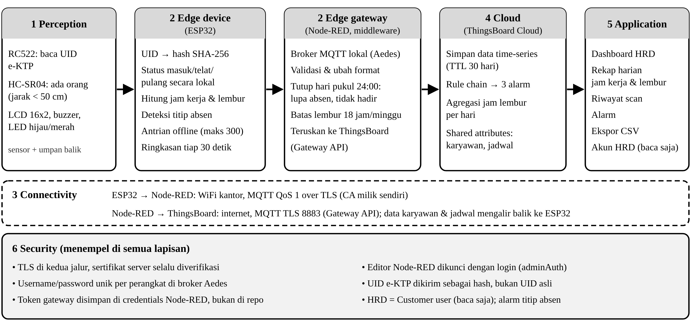

# Sistem Absensi Karyawan Berbasis IoT dengan Chip e-KTP

Proyek akhir mata kuliah **Internet of Things (CIT60029)**, Universitas Brawijaya, 2026.

| Nama | NIM |
|---|---|
| Hasan Huzaifi | 245150700111003 |
| Raffi Putra Nugraha | 245150700111004 |
| Muhammad Alvin Satria | 245150700111006 |

Karyawan menempelkan e-KTP ke alat di pintu masuk. ESP32 memutuskan sendiri absen masuk, terlambat, atau pulang (lengkap dengan jam kerja dan lembur), mencegah titip absen dengan sensor jarak, dan tetap bekerja saat internet putus. Data dikirim terenkripsi ke Node-RED lalu ke ThingsBoard Cloud, tempat HRD melihat dashboard, alarm, dan mengekspor data.

## Arsitektur enam lapisan

| Lapisan | Isi |
|---|---|
| Perception | ESP32 DevKit V1, RC522 (UID chip e-KTP), HC-SR04 (orang di depan alat), LCD 16x2 I2C, buzzer, LED hijau & merah |
| Edge | Firmware ESP32: hash UID, keputusan absen lokal, hitung jam kerja & lembur, deteksi titip absen, antrian offline (LittleFS), ringkasan tiap 30 detik |
| Connectivity | WiFi 2.4 GHz, MQTT QoS 1 lewat **TLS port 8883** (ESP32 → Node-RED dan Node-RED → ThingsBoard) |
| Cloud / middleware | Node-RED (broker Aedes, rekap harian, Gateway API) dan **ThingsBoard Cloud** (penyimpanan time-series TTL 30 hari, rule chain, 3 alarm) |
| Application | Dashboard *Absensi Karyawan e-KTP*: kartu angka hari ini, riwayat scan, rekap harian, grafik lembur per hari (agregasi SUM), alarm, ekspor data |
| Security | TLS dengan CA terverifikasi, kredensial unik per pemasangan (tidak ada di repositori), UID e-KTP di-hash, akun Customer HRD yang hanya bisa melihat |

Alur data: **ESP32 (edge) → MQTT TLS 8883 → Node-RED → MQTT TLS 8883 (Gateway API) → ThingsBoard → dashboard HRD**

## Aturan absensi (bawaan, diatur lewat shared attribute `jadwal`)

- Kartu hanya diterima bila HC-SR04 mendeteksi orang < 50 cm.
- Absen masuk sekali sehari, mulai 07:00. Lewat 08:00 tetap hadir, dicatat terlambat beserta menitnya.
- Absen pulang sekali sehari, dari 17:00 sampai sebelum 21:00. Istirahat 12:00–13:00 dipotong otomatis.
- Lembur setelah 17:00, minimal 30 menit, kelipatan 30 menit, maksimal 4 jam/hari dan 18 jam/minggu (PP 35/2021).
- Tidak absen pulang sampai 21:00 = lupa absen pulang: pulang dicatat 17:00, lembur 0, alarm di ThingsBoard.
- Di luar aturan itu alat hanya memberi peringatan (LCD, LED, buzzer) dan tidak mencatat apa pun.

Rincian lengkap dan skenario uji: [PANDUAN.md](PANDUAN.md) bagian C dan D.

## Isi repositori

| Folder / file | Isi |
|---|---|
| `MULAI.bat` | Satu-satunya file yang perlu diklik: setup ThingsBoard, sertifikat, upload firmware, menyalakan Node-RED |
| `1-arduino/absensi_karyawan/` | Firmware ESP32 (Arduino IDE 2, ESP32 core 3.x). `secrets.example.h` adalah contoh; `secrets.h` dibuat otomatis dan tidak diunggah |
| `2-node-red/data/` | Flow Node-RED (`flows.json`), pengaturan, daftar node tambahan |
| `3-thingsboard/` | Dashboard, rule chain alarm, dan atribut awal untuk diimpor ke ThingsBoard |
| `tools/`, `lanjutan/` | Skrip pendukung MULAI.bat dan cara manual per langkah |
| `sertifikat/thingsboard-ca.pem` | Sertifikat CA publik ThingsBoard Cloud |
| `dokumen/` | Analisis ancaman, panduan setup ThingsBoard, catatan versi, gambar |

## Cara menjalankan

1. Siapkan Node.js LTS, Arduino IDE 2, Chrome/Edge, dan akun ThingsBoard Cloud.
2. Rakit alat sesuai `dokumen/gambar/peta_breadboard.png` dan sambungkan ESP32 ke laptop.
3. Klik dua kali `MULAI.bat`, ikuti layar (login ThingsBoard sekali, isi password WiFi), lalu berikutnya cukup tekan ENTER.

## Keamanan dan kredensial

File rahasia dibuat di laptop masing-masing saat `MULAI.bat` dijalankan dan **tidak pernah masuk repositori** (lihat `.gitignore`): `rahasia.json` (password broker, token gateway ThingsBoard, password editor), `secrets.h` (WiFi dan kredensial MQTT ESP32), `ca_cert.h`, dan kunci/sertifikat di `sertifikat/`. Analisis ancaman satu halaman: [dokumen/Analisis_Ancaman_Absensi_eKTP.pdf](dokumen/Analisis_Ancaman_Absensi_eKTP.pdf).
